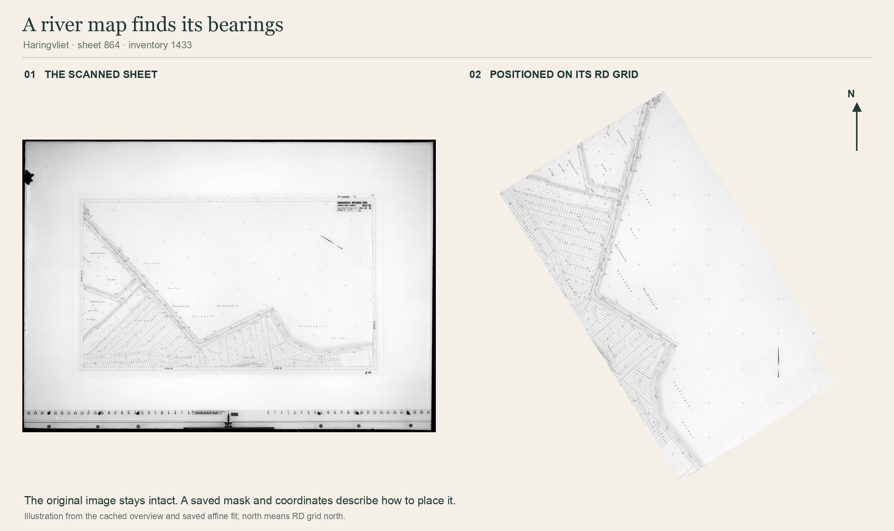
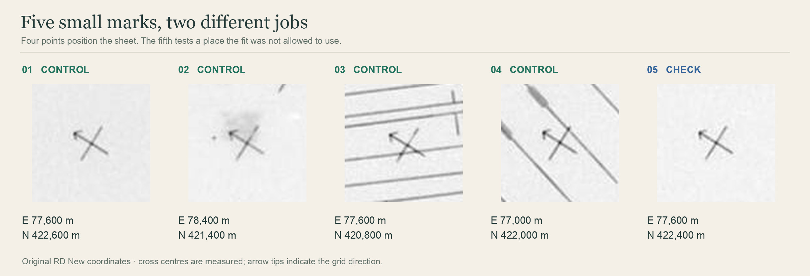
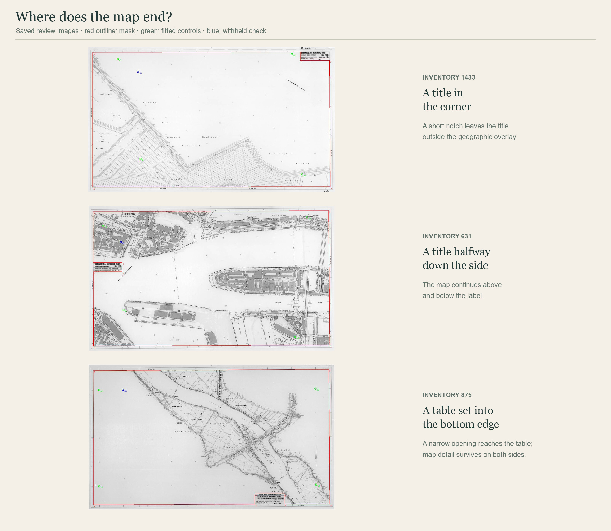
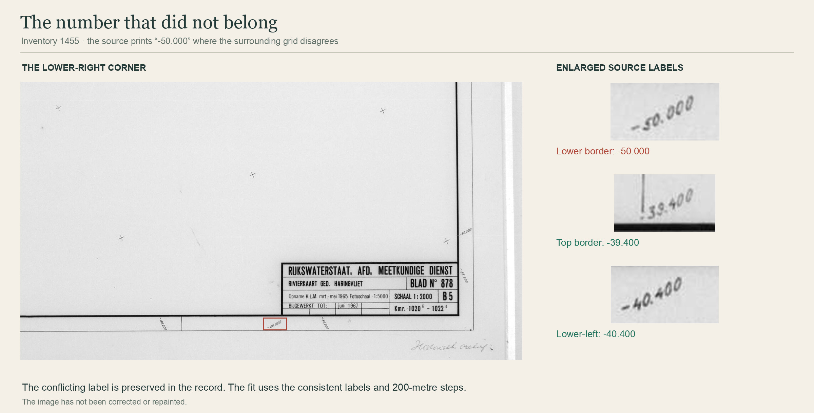
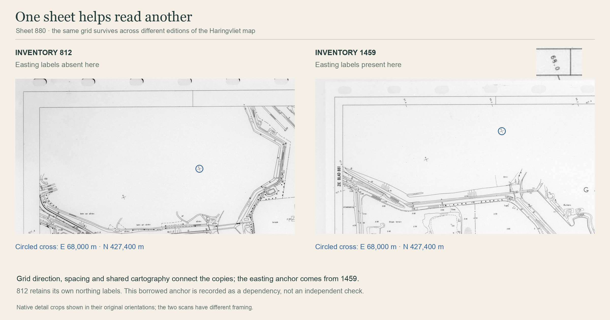
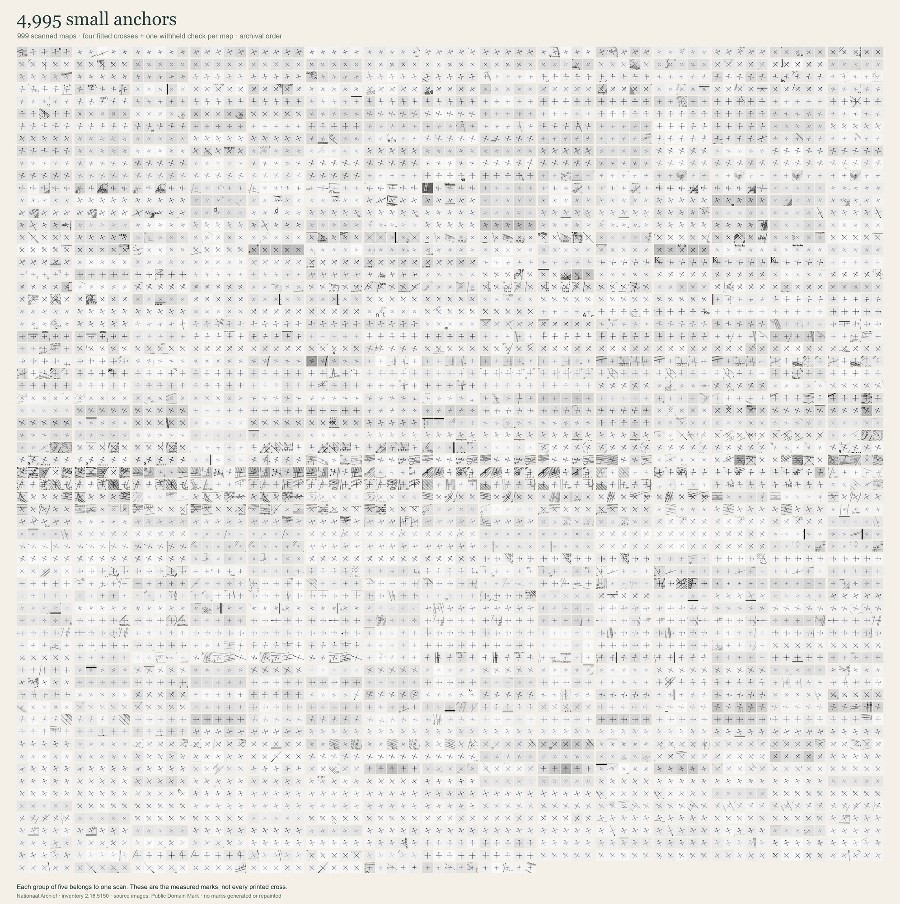

# 4,995 small anchors

*How code, close looking, and a few stubborn numbers gave the Nieuwe Stijl river maps their place in the world.*

North, on these maps, is often somewhere off to the side. A river bends across the sheet; fields, dykes and harbours follow it. A modern map viewer needs to know how to turn that sheet, how large to make it, and precisely where it belongs.

That was the work of georeferencing the digitized Nieuwe Stijl river maps from Nationaal Archief. A scan gives us a picture. Georeferencing gives places within that picture geographical addresses. The original image remains intact; a separate annotation tells software how to position it.

The best clues were already on the paper: small crosses, sometimes with arrowheads, and numbers quietly printed along the borders.



*Inventory 1433, sheet 864. The right-hand illustration uses the saved placement and mask, applied to a small cached overview. It shows the change in orientation; it is not a screenshot of a new survey or a modern basemap.*

## Reading the border

The crosses belong to a coordinate grid. Each selected cross has two addresses: its position in the scanned image, measured in pixels, and its position on the ground, measured eastward and northward in metres. These ground coordinates are called eastings and northings. The little arrows help establish which way the grid runs, even when the sheet is turned at an unfamiliar angle. Border labels supply the numbers; counting grid intervals connects those numbers to a particular cross.

The first surprise was that the collection used both the older and newer versions of the Dutch RD coordinate system. Some labels were negative. Others expressed distances in metres, hundreds of metres, or kilometres. A dot could be part of a kilometre value or a thousands separator. Reading a number meant reading its neighbours too.

We kept the printed text, its units and the original coordinate values. Reviewed older coordinates were converted explicitly to RD New, then PROJ, a coordinate-conversion library, supplied longitude and latitude for the viewer. Keeping the original observations makes that conversion traceable.



*These are actual source crops. The intersection is the measured point; the arrow tip helps read its direction. Nearby roads and field boundaries make some intersections much harder to isolate.*

## Code did the repetition; Vision read the context

I used conventional computer vision to propose straight map borders, compare related scans, and refine the centres of crosses. Those operations are good at repeating a precise measurement. They do not, by themselves, establish that a dark line is the right border or that a number belongs to the intended cross.

Vision—the AI's ability to inspect images—provided that contextual reading. I looked at enlarged sections, transcribed labels, followed the rotated grid, and checked whether proposed points landed on real intersections. A reviewed starting point then gave the code a small area in which to measure more precisely. The code returned measurements and diagnostic pictures for another look.

Neither part was infallible. A faint 3 could resemble a 5; a 4 could resemble an 8. Repeated editions looked similar enough to tempt automatic matching, while their framing and contents had changed. On inventory 1367, a cross overlapped a wharf edge. We chose a cleaner neighbouring cross, traced its coordinate through the grid, and fitted again.

The useful pattern was a loop: propose, inspect, measure, test, inspect again. The final controls and masks received an AI visual check. Human inspection in Allmaps remained a separate review.

Close looking also meant being considerate to the archive. We began with small overviews, then requested bounded sections at higher resolution where needed. Requests were spaced out and cached. That made revisiting a difficult label cheap, and these essay illustrations required no new image requests.

## Cutting a window around the geography

A map scan includes more than a map: margins, titles, tables and sometimes the photographic setup. To overlay the geography neatly, each annotation also needs a *mask*: an outline saying which part of the image to display.

The title boxes refused to stay in one convenient corner. Some sat halfway down a side. One table was inset from the bottom edge, with useful map detail on both sides. A simple rectangle would either leave the table floating over the landscape or throw away geography. We drew notches around these intrusions, checking the outline against the scan. Titles and archival descriptions still survive in the original image and metadata.



*Crops of the actual review images: inventories 1433, 631 and 875. Red follows the retained map area; green marks fitted points and blue the withheld check. The small opening below the last table lets one continuous outline exclude it.*

## When the map disagreed with itself

Inventory 1455 supplied a particularly good puzzle. Its lower and right borders visibly read **−50.000**. Elsewhere, the northings and 200-metre grid steps belonged around −39,400 to −40,800 metres. The awkward number was on the source itself.

We preserved the anomalous label in the record and excluded it as a starting coordinate. The consistent top and left labels, followed through the grid, supplied the point values instead. The scan remains unchanged, and the record explains the decision. It still carries a numerical review flag: resolving the label did not make every discrepancy disappear.



*The red box locates the first enlargement. The other two crops come from the top and lower-left borders of the same scan. We can document the contradiction without claiming to know how it arose.*

Inventory 812 posed the opposite problem: its four corner details contained no surviving easting labels. Its northing labels were available, but half the address was missing. Other editions of the same sheet, inventories 1459 and 1460, retained the labels. Comparing their grid and shared cartography supplied the missing easting anchor.

That relationship is recorded explicitly. The result depends on another sheet's evidence, so agreement between those copies cannot be counted as an independent confirmation of their absolute location.



*Different framing and changed harbour detail make comparison less simple than stacking two identical pictures. The enlarged “68.0” on 1459 supplies an easting of 68,000 metres; 812 retains its own northing evidence.*

## Giving the answer a chance to be wrong

Three well-spaced points can determine the transformation we used. We measured five on each scan: four to position the map, one held aside to check it.

The fitted transformation can turn, resize, stretch and shear the image while keeping straight lines straight. With four points, the measurements have to agree on more than the minimum information needed. Least-squares adjustment finds the best compromise and reports what remains unexplained. The fifth point asks whether that compromise also works somewhere it was not fitted to.

This catches many mistakes. It cannot catch everything. If all the coordinate labels were assigned the same wrong starting value, a beautifully neat fit could still land in the wrong place. Reading the border remains essential. Small pixel discrepancies also do not establish the accuracy of the original historical survey.

We kept the same screening limits throughout: two native-image pixels for the fitted points' root-mean-square error, and five for the withheld check. Cases exceeding those limits stayed flagged. Inventories 751 and 1381 initially retained large discrepancies whose cause we had not established. Later human review prompted another look: two crosses on each map had been assigned the wrong grid step. Correcting those assignments removed the strong skew. The earlier suggestion of possible paper or scan distortion was superseded by this evidence.

We also tested whether joining overlapping images would help. Computer vision proposed matching features; six matches were visually checked, and `@allmaps/attach` used three while the other three tested the result. On that pilot pair, the overlap agreed slightly better, but the withheld grid checks worsened. We therefore kept the grid-based placements as the baseline. A smoother seam alone was not enough evidence of a better position.

A [later review of the complete collection](nieuwe-stijl-review-2026-11-20.md) exposed a further weakness. Four copies of one sheet shared the same skewed coordinate assignment, yet their numerical fits looked convincing. Another sheet had its east and north values swapped; a third was 400 metres too far north. These were errors in our annotations, found through human inspection. We corrected them against the printed labels and added explicit checks for reflection, skew and unequal stretching across all 999 maps. That screen found two additional affected copies. It also made the collaboration clearer: visual inspection and small residuals both need checks of their own.

## A collection of tiny signatures

[](images/georeferencing-essay/06-all-crosses-full.jpg)

*[Open the full-resolution mosaic](images/georeferencing-essay/06-all-crosses-full.jpg). Each group of five belongs to one scan, in archival order: four controls followed by a check. These are all the crosses selected for measurement, rather than every cross printed in the collection. Repeated editions can show the same ground location. The mosaic reflects the corrected measurements after the 20 November review. The crops retain their source orientations and tones; six sit against the edge of the available evidence.*

Seen together, the crosses become a portrait of the work. Some sit alone in pale water. Others are tangled in lettering, field boundaries or harbour engineering. Their changing angles explain, almost without words, why treating every sheet as north-up would have failed.

What I came to appreciate most was the precision of these small, practical marks. The rivers draw your attention first; then you notice the carefully hatched banks, tiny labels and arrowheads that make the whole drawing recoverable. Even the handwritten “Historisch archief” below the troublesome label in 1455 has its place in that story. These were working documents, and their accumulated detail rewards patient reading.

As of **20 November 2026**, all **999 digitized maps** have prepared annotations. **All 999 have now been accepted in human review, including the corrected placements.** The ten sheet indices are excluded. We moved from a 24-scan pilot to larger batches and then complete series, refreshing the [dashboard](../../dashboard/index.html) as each finished. It brings the maps together for inspection while preserving the individual records, corrections and unresolved flags.

The result is a way to place these sheets beside one another and look again, with their evidence still attached.

---

### Images and working record

Source scans: **Nationaal Archief**, inventory **2.16.5150**, Nieuwe Stijl. The saved archival metadata marks the scans with the **Public Domain Mark**. The figures combine source crops and saved review overlays; no map marks were generated or repainted. The north-up illustration resamples a cached overview using the saved transformation. Text, coloured highlights and layout are explanatory additions.

The [pilot report](nieuwe-stijl-pilot-results.md), [D.15 report](nieuwe-stijl-batch-15-results.md), [D.16 report](nieuwe-stijl-batch-16-results.md) and [technical method](nieuwe-stijl-georeferencing.md) document the examples and checks. The [figure provenance](images/georeferencing-essay/provenance.json) identifies source crops, image checksums and the canonical record for every mosaic tile. Those records preserve original coordinates, border readings, conversions and review notes.

The [figure-building script](../../scripts/georeferencing/georeference-essay-figures.py) reproduces the illustrations offline with the project's Python environment and existing image cache:

```sh
.venv/bin/python scripts/georeferencing/georeference-essay-figures.py
```

Use `--cache-root /path/to/.cache/georeferencing` if the cache is held elsewhere. The script verifies source-image checksums and the complete set of 999 scans and 4,995 points before completing the provenance file. Fonts may change the typography across platforms; the source measurements stay the same.
